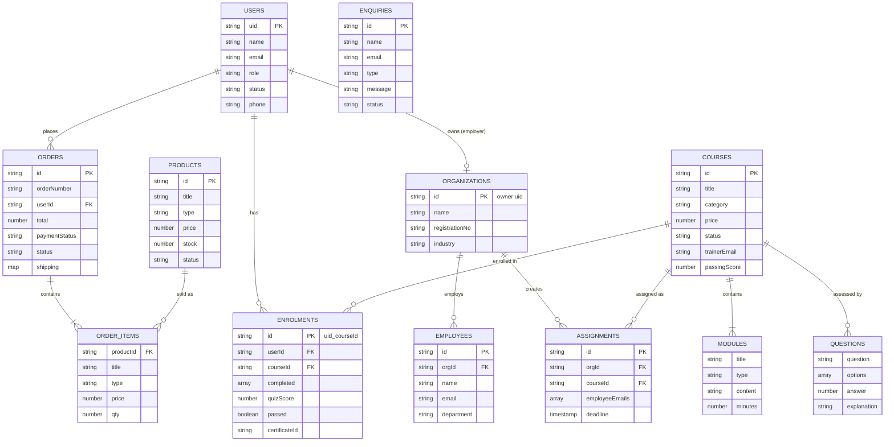

# MT Alchemy Corporate Platform

A Flutter + Firebase web platform for MT Alchemy, a people-development consultancy. It combines a brand website, a small learning management system (LMS), an online store and separate portals for learners, employers, trainers and administrators.

Live site: https://mt-alchemy-client.web.app

## Features by module

| Module | What works |
|---|---|
| Website | Home, About, Services, Upskilling (Learning Hub), Store, Contact; responsive menu with a drawer on small screens |
| Authentication | Register as Individual or Employer (employers also create their organisation), login, profile edit, password reset email, role read from Firestore |
| LMS | Course catalogue with category filters, course detail, enrolment (free, paid or employer-assigned), modular course player (text / video / PDF), progress %, multiple-choice quiz with retake, certificate with QR code and PDF download |
| Store | Digital and physical products, product detail, cart with quantities, discount and shipping, checkout, test-mode payment (Successful / Failed / Pending), order confirmation, My Orders with tracking, My Digital Products (downloads only after a paid order) |
| Employer | Organisation overview, add/remove employees, purchase seats and assign a course with a deadline, progress table, PDF report export |
| Trainer | Assigned courses, edit learning materials and quiz, learner progress and quiz scores |
| Admin | Overview stats, create/edit/delete courses and products, order status workflow, user roles and activation, enquiry inbox, organisations, demo-data seeding |

## User journeys

- **A. Individual learning:** Register → Upskilling → course → pay → enrol → player → quiz → certificate
- **B. Digital product:** Store → product → cart → checkout → payment → confirmation → My Digital Products → download
- **C. Physical product:** Store → cart → checkout with shipping address → payment → admin moves the order through Paid → Processing → Shipped → Delivered
- **D. Employer:** Register organisation → add employees → purchase and assign course → employee completes it → employer views progress and exports a report
- **E. Corporate enquiry:** Contact form → enquiry saved → admin manages it (New → Contacted → Consultation → Proposal Sent)

## Roles

| Role | How to get it | Access |
|---|---|---|
| Guest | Not signed in | Browse site, courses and store, send enquiries |
| Individual | Self-register | Learn, buy, view own orders and certificates |
| Employer | Self-register | Organisation, employees, assignments, reports |
| Trainer | Admin sets the role and assigns courses by trainer email | Assigned courses and their learners |
| Super Admin | Set `role: "Super Admin"` on the user document in the Firestore console (first admin only); after that, from Admin → Users | Everything |

Access is enforced twice: by the UI (each role sees its own dashboard) and by `firestore.rules` on the server.

## Architecture

```
lib/
  main.dart                 app entry, providers, website shell and public pages
  theme.dart                brand colours, category visuals, ThemeData
  models/                   Course, Product, ShopOrder, Enrolment, Organization, Employee, Assignment, Enquiry
  services/
    firestore_service.dart  every Firestore read/write (class Db)
    payment_service.dart    PaymentGateway interface + MockPaymentGateway
    pdf_service.dart        certificate, digital product and employer report PDFs
    seed_data.dart          demo catalogue
  state/                    AppState (auth + profile) and Cart, shared with Provider
  pages/
    learning/               catalogue, course detail, player, quiz, certificate
    store/                  catalogue, product, cart, checkout, payment, orders, library
    dashboard/              learner, employer and trainer dashboards
    admin/                  admin portal and course editor
  widgets/ui.dart           shared UI pieces (PageScaffold, Panel, StatusChip, StreamView...)
```

State management uses **Provider**: `AppState` listens to Firebase Auth and loads the user's Firestore profile; `Cart` holds the basket and pricing rules.

## Database (Cloud Firestore)



Modules, questions and order items are stored inside their parent document (Firestore reads the whole course or order at once). They are separate entities in the diagram.

## Setup

1. Install the [Flutter SDK](https://docs.flutter.dev/get-started/install) (3.47 or newer) and run `flutter doctor`.
2. Clone the repository and install packages:
   ```
   git clone https://github.com/AkshithaKK/mt-alchemy.git
   cd mt-alchemy
   flutter pub get
   ```
3. Run on the web:
   ```
   flutter run -d chrome                         # or
   flutter run -d web-server --web-port 8080     # then open http://localhost:8080
   ```
4. Run the tests: `flutter test`.

The Firebase project (`mt-alchemy-client`) is already configured in `lib/firebase_options.dart`. To point the app at a different project, run `flutterfire configure`.

## First-time data setup

1. Register an account, then in the Firebase console open Firestore → `users` → your document and set `role` to `Super Admin`.
2. Sign in again, open the Dashboard → Admin Portal → Overview → **Seed demo data**.
3. Create demo accounts for each role. Assign a course to a trainer by entering the trainer's email in the course editor.

## Deploying

```
flutter build web --release
firebase deploy --only hosting,firestore:rules
```

## Maintenance guide

- **Add or change a course:** Admin Portal → Courses → Create course / edit. Set status to Published to show it publicly. Modules support the `text`, `video` and `pdf` types.
- **Add a new lesson content type:** add an entry to `moduleViewers` in `lib/pages/learning/course_player.dart` and the option in `course_editor.dart`. The player itself does not change.
- **Add a product:** Admin Portal → Products → Add product. Draft products stay hidden.
- **Go live with payments:** implement `PaymentGateway` in `lib/services/payment_service.dart` for a real provider and assign it to `paymentGateway`. Checkout, enrolment and course assignment already use this interface.
- **Change access rules:** edit `firestore.rules` and deploy with `firebase deploy --only firestore:rules`.
- **Change branding:** colours and theme live in `lib/theme.dart`.

## Known limitations (planned for the final release)

- The payment gateway runs in test mode; no real money moves.
- Video lessons show a placeholder; uploading media to Firebase Storage is planned.
- Quiz answers are stored in the course document, which the browser can read. Marking should move to a Cloud Function.
- Employers can read enrolment progress for any user; this should be narrowed to their own employees.
